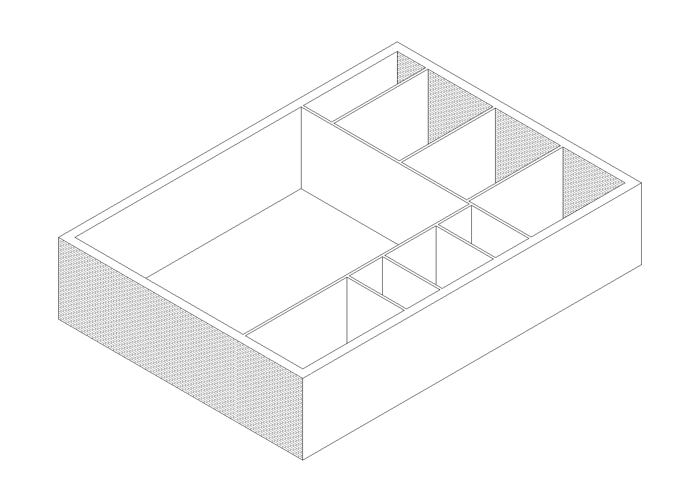
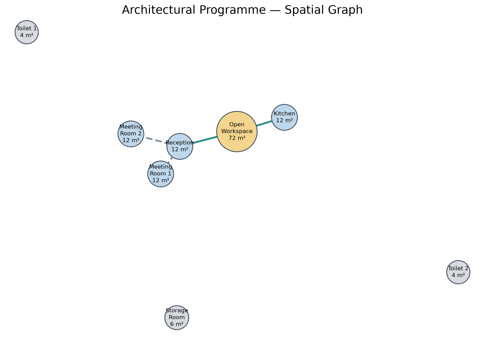
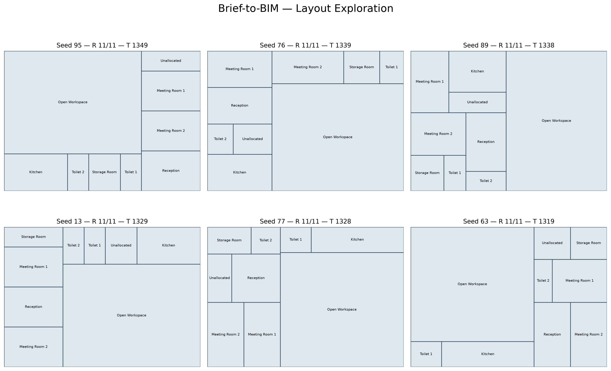
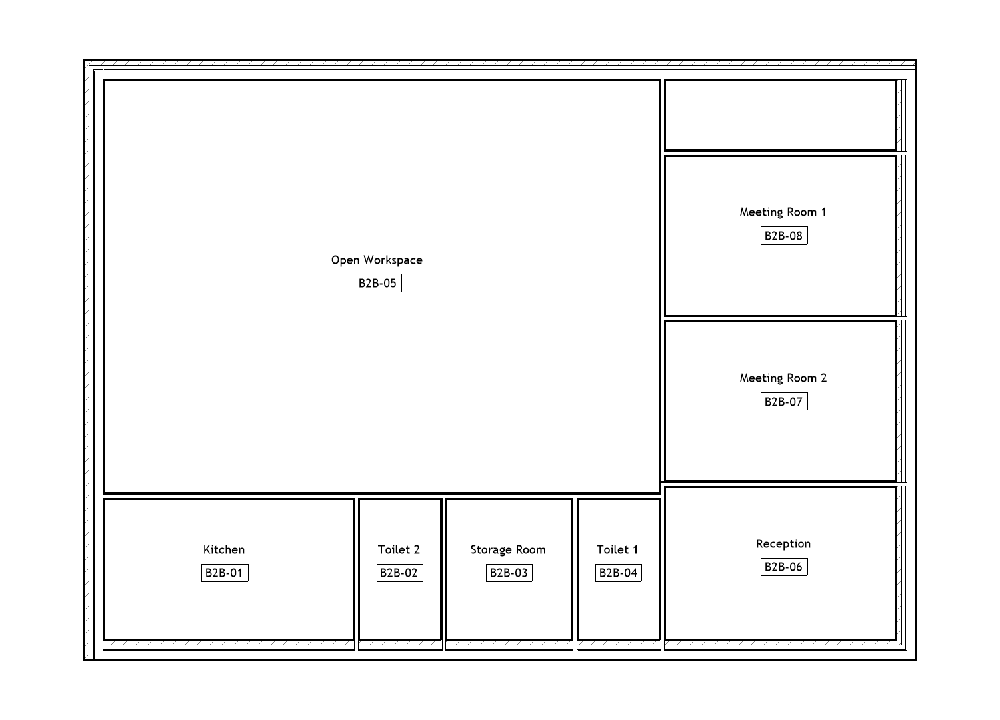

# Brief-to-BIM

**From natural-language architectural briefs to generative layouts and native Revit BIM models.**

A Python-based proof of concept exploring how Large Language Models, structured architectural data and generative algorithms can be connected to Building Information Modelling workflows.



## Overview

Brief-to-BIM transforms an architectural brief written in natural language into a structured spatial programme, generates and evaluates alternative floor plans, and translates a selected solution into native Revit elements.

The workflow separates three tasks:

- **AI interpretation:** An LLM extracts spaces, target areas and spatial relationships from an architectural brief.
- **Computational design:** Python generates and evaluates alternative spatial configurations.
- **BIM integration:** A custom pyRevit extension creates walls, Rooms and Room Tags using the Revit API.

## Workflow

**01 — Natural language → Structured data**

An OpenAI language model interprets an architectural brief and produces a structured JSON programme, validated using Pydantic. The data includes room areas, privacy and daylight requirements, and adjacency relationships.

**02 — Spatial graph**

NetworkX converts the programme into a graph of spaces and relationships.



**03 — Generative layout exploration**

A custom Binary Space Partitioning (BSP) algorithm generates rectangular room layouts within a predefined building envelope.

The prototype explores 100 configurations using reproducible random seeds. Alternatives are evaluated according to spatial relationships, room proportions and a simplified façade-access criterion.



**04 — BIM generation**

The selected layout is transferred to Autodesk Revit through a custom pyRevit extension.

The Revit API creates native model lines, walls, Rooms and Room Tags. Revit then calculates actual room areas, allowing comparison with the original programme.



## Prototype results

The demonstration uses a small architecture office for 12 people.

| Parameter | Result |
|---|---|
| Building envelope | 140 m² |
| Programmed spaces | 8 |
| Target programmed area | 134 m² |
| Generated alternatives | 100 |
| Selected configuration | Seed 95 |
| Spatial relationship score | 11/11 |
| Revit-calculated room area | 123.22 m² |

The difference between target and Revit room areas illustrates the transition from idealised geometric partitions to BIM elements with wall thickness and spatial boundaries.

[View the Revit Room Schedule](outputs/presentation/room_schedule.pdf)

## Technologies

**Python · OpenAI API · Pydantic · NetworkX · Matplotlib · JSON · Binary Space Partitioning · Revit 2027 · Revit API · pyRevit · Dynamo**

## Repository structure

- `src/` — LLM parsing, data validation, spatial graphs, layout generation and evaluation
- `data/` — Example architectural brief and structured programme
- `outputs/` — Generated layouts, reports, diagrams and BIM presentation images
- `pyrevit/` — Custom Revit extension with three commands: Import Layout, Create Walls and Create Rooms
- `revit/` — Initial Dynamo interoperability experiment
- `requirements.txt` — Python dependencies

## Getting started

### Python workflow

Install Python 3 and clone the repository:

```powershell
git clone https://github.com/esanzgadea/brief-to-bim.git
cd brief-to-bim
python -m venv .venv
.\.venv\Scripts\Activate.ps1
pip install -r requirements.txt
```

To use the LLM parser, copy `env.example.txt` to `.env` and add your own `OPENAI_API_KEY`. OpenAI API access is billed separately.

Run the workflow from the repository root:

```powershell
python src/brief_parser.py
python src/validate_programme.py
python src/build_graph.py
python src/explore_layouts.py
python src/report_layout.py
```

The repository also includes example JSON outputs, so the layout-generation stages can be explored without making new API requests.

### Revit workflow

1. Install Revit 2027 and a compatible version of pyRevit.
2. Register the repository's `pyrevit/` directory as a custom extension folder.
3. Reload pyRevit and open a floor plan in an architectural project with basic wall types and Room Tags available.
4. Run **Import Layout** for model-line geometry, or **Create Walls** followed by **Create Rooms** to generate the BIM elements.

The commands read `outputs/best_layout.json`.

Use a clean test model: the prototype does not automatically replace previously generated elements.

## Scope and limitations

This is an early-stage computational workflow prototype, not a complete architectural design system.

The current implementation supports a single rectangular floor plate and orthogonal partitions. It does not yet resolve circulation, door placement, accessibility, structural constraints or building regulations.

Daylight evaluation uses façade contact as a simplified geometric proxy rather than environmental simulation.

The project demonstrates an interoperable pipeline between natural-language requirements, structured architectural information, generative computation and native BIM modelling.